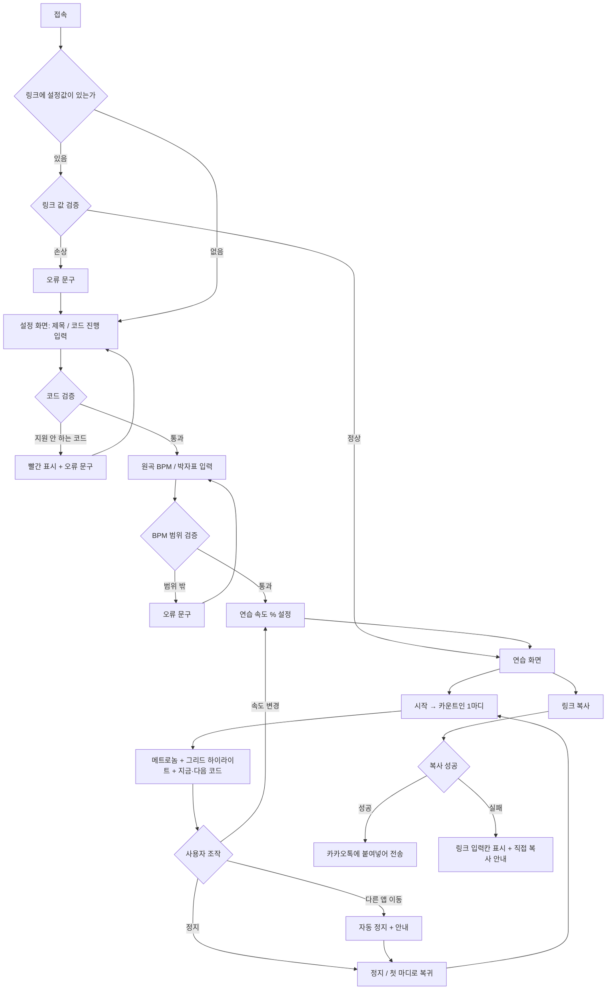

# PRD_SlowStrum

> 교회 찬양팀 기타 레슨을 위한 **코드 다이어그램 + 느린 메트로놈 + 박자 그리드** 연습 웹페이지
> 작성자: 박지훈 (명지대 컴퓨터공학과) · 버전: v1.0 (MVP)

---

## 1. 프로젝트 개요

### 해결하려는 문제
나는 대학생이고, 일요일마다 교회에서 찬양팀 기타를 치는 고등학교 1학년 학생 두 명(김유호, 김예찬)에게 기타를 가르친다. 레슨을 하면서 아래 두 가지 문제가 반복된다.

1. **운지법 전달에 드는 작업**: 레슨에서 가르친 코드의 운지법을 매번 인터넷에서 찾아 캡처한 뒤 카카오톡으로 보낸다. 곡이 바뀔 때마다 검색 → 캡처 → 전송을 다시 해야 한다. 사이트마다 다이어그램 표기 방식이 달라서 학생이 받는 자료의 형식도 매번 다르다.
2. **집 연습 기준 부재**: 캡처 이미지는 코드 모양만 보여주고, 어떤 순서·속도·박자로 코드를 바꿔야 하는지는 담지 못한다. 학생은 평일에 집에서 코드 전환을 어떻게 연습할지 모른다. 그 결과 일요일 레슨 한 번에 20분 넘게 지난주 코드를 복습하는 데 쓴다.

### 왜 중요한가
- 찬양팀 연주는 매주 일요일 예배에서 팀과 함께 진행된다. 예배 중에는 혼자 멈추거나 속도를 늦출 수 없기 때문에, 학생은 다음 일요일 전까지 정해진 속도에서 코드 전환을 박자에 맞출 수 있어야 한다.
- 레슨도 일요일에만 있다. 복습에 20분 이상 쓰면 그만큼 다음 주 곡을 배우는 시간이 줄고, 준비가 덜 된 상태로 다음 예배에 서게 된다.
- 복습이 길어지는 원인 중 하나는 학생이 받은 자료에 연습 기준(속도, 박자, 전환 시점)이 없다는 점이다. 자료에 이 기준이 들어가면 학생은 평일에도 레슨과 같은 방식으로 연습할 수 있다.
- 운지법 검색·캡처는 매주 곡 수만큼 반복된다. 코드 진행을 한 번 입력해서 같은 형식의 자료가 나오면 이 반복 작업이 없어진다.

### 목적
- 코드 진행만 입력하면 운지 다이어그램이 같은 형식으로 자동 표시되게 해서, 검색·캡처 작업을 없앤다.
- 같은 화면에서 느린 메트로놈과 박자 그리드로 코드 전환 시점을 보여줘서, 학생이 평일에 무엇을 어떤 속도로 연습할지 알 수 있게 한다.
- 입력한 진행을 링크 하나로 만들어 카카오톡으로 보내게 한다. 학생은 로그인 없이 링크를 열면 바로 연습 화면을 본다.
- 이를 통해 일요일 레슨의 복습 시간을 줄이고, 줄어든 시간을 다음 주 곡 준비에 쓴다.

### 범위 조건
- 로그인·회원가입 없음, 서버 저장 없음.
- 웹페이지 하나 안에서 진행 입력 → 다이어그램 표시 → 박자 연습 → 링크 공유가 모두 끝난다.
- 링크 공유는 제목·코드 진행·BPM·박자표를 URL 안에 담는 방식으로 한다. 그래서 서버나 데이터베이스가 필요 없다.

### 한 줄 정의
**코드 진행을 입력하면 운지 다이어그램과 느린 메트로놈 연습 화면을 링크 하나로 만들어 주는, 로그인 없는 찬양팀 기타 레슨용 웹페이지.**

---

## 2. 주요 타겟

### 대표 사용자 (학생)
| 항목 | 내용 |
|---|---|
| 인물 | 김유호, 김예찬 (고등학교 1학년), 교회 찬양팀 기타 담당 |
| 기타 실력 | 기본 오픈 코드 모양은 알지만, 코드 전환이 박자를 못 따라감 |
| 사용 상황 | 일요일: 예배 연주 + 레슨. 평일: 학교·학원이 끝난 저녁에 집에서 짧게 연습 |
| 사용 기기 | 스마트폰. 카카오톡으로 받은 링크를 눌러 바로 연다 |
| 현재 해결 방식 | 카카오톡으로 받은 운지법 캡처 사진을 넘겨 보며, 박자 기준 없이 코드 모양만 반복해서 잡아 봄 |
| 불편한 점 | 캡처 사진이 대화방에 흩어져 있어 이번 주 곡 코드를 다시 찾기 어렵고, 어떤 속도로 연습해야 할지 기준이 없음 |
| 회원가입 | 원하지 않음. 평일 연습 시간이 짧아서, 가입 단계가 있으면 연습 시작이 그만큼 늦어짐 |

### 보조 사용자 (가르치는 사람)
작성자 본인. 대학생이며 일요일마다 교회에서 찬양팀 학생 두 명에게 기타를 가르친다. 레슨에서 다음 주 곡의 코드 진행을 입력해 화면으로 함께 연습하고, 레슨이 끝나면 그 진행을 링크로 만들어 카카오톡으로 보낸다.

---

## 3. 핵심 기능 (MVP)

| 우선순위 | 기능 | 설명 | 완료 기준 |
|---|---|---|---|
| P1 | **코드 다이어그램 자동 표시** | 코드 진행을 입력하면 운지 다이어그램이 같은 형식으로 표시된다. 연습 중에는 **지금 코드(크게)** 와 **다음 코드(작게)** 를 나란히 보여준다 | `G:4 D/F#:4 Em:4 C:4`를 입력하면 4개 코드의 다이어그램이 모두 표시되고, 재생 중 4박자마다 지금·다음 코드가 바뀐다 |
| P1 | **감속 메트로놈 + 박자 그리드** | 원곡 BPM을 입력하고 연습 속도를 %로 낮춘다 (25%~100%, 5% 단위). 마디×박자 칸 그리드에서 현재 박자가 메트로놈 소리와 함께 하이라이트되고, 코드가 바뀌는 칸에 코드명이 붙는다 | 원곡 120 BPM에서 50%를 고르면 60 BPM으로 소리가 나고 "60 BPM (원곡의 50%)"가 표시된다. 10분 재생해도 소리와 하이라이트가 어긋나지 않는다 |
| P1 | **연습 링크 공유** | 제목·진행·원곡 BPM·박자표·연습 속도를 URL에 담은 링크를 만든다. [링크 복사] 후 카카오톡에 붙여넣어 보낸다 | 복사한 링크를 카카오톡에서 열면 로그인 없이 같은 설정의 연습 화면이 바로 열린다 |

### 없어도 되는 기능 (MVP에서 뺌)
여러 곡 묶음 링크, 진행 저장, 가사 표시, 카포 계산, TAB 악보, 스트로크 패턴 → 6장 제외 범위 참고

---

## 4. 사용자 흐름

### 가르치는 사람 (일요일 레슨)
1. 노트북 또는 스마트폰으로 웹페이지에 접속한다.
2. 다음 주 곡의 제목과 코드 진행을 입력한다.
3. 원곡 BPM과 박자표를 입력한다.
4. 연습 속도를 학생 수준에 맞춰 낮춘다.
5. [시작]을 누르고 학생과 함께 그리드를 보며 연습한다.
6. 학생이 막히는 마디에서 [정지]를 누르고, 속도를 더 낮춰 다시 시작한다.
7. 레슨이 끝나면 [링크 복사]를 누른다.
8. 카카오톡 대화방에 링크를 붙여넣어 보낸다.

### 학생 (평일 집 연습)
1. 카카오톡에서 받은 링크를 누른다 (가입 없음).
2. 선생님이 정한 제목·진행·연습 속도로 연습 화면이 열린다.
3. [시작]을 누르고 1마디 카운트인을 듣는다.
4. 그리드 하이라이트와 코드 다이어그램을 보며 따라 친다.
5. 익숙해지면 연습 속도를 5%씩 올린다.
6. 원곡 속도(100%)에서 끝까지 이어서 치는 것을 목표로 반복한다.

### 예외 상황
- **지원하지 않는 코드 입력** (예: `Cadd9#11`) → 해당 코드에 빨간 표시, [연습 화면으로]·[링크 복사] 비활성화
- **코드 진행이 비어 있음** → 버튼 비활성화, 안내 문구 표시
- **BPM이 범위 밖** (40 미만, 200 초과) → 입력칸 아래 오류 문구
- **계산된 실제 BPM이 20 미만** → 20 BPM으로 고정하고 안내
- **링크 값이 손상됨** (잘린 링크, 지원하지 않는 코드가 들어간 링크) → 오류 문구 표시 후 빈 설정 화면으로 이동
- **클립보드 복사 실패** → 링크 전체를 선택 가능한 입력칸에 보여주고 직접 복사하도록 안내
- **브라우저가 소리를 막음** (사용자 조작 전 자동재생 차단) → [시작] 버튼을 누른 순간에 오디오를 켠다
- **재생 중 다른 앱·탭으로 이동** → 재생 정지 후 안내 문구 표시

### 순서도

---

## 5. 입력과 출력

### 화면 A: 설정 화면

| 항목 | 입력 (형식 / 제한) | 처리 | 출력 (화면) |
|---|---|---|---|
| 제목 | 텍스트, 선택 입력, 최대 30자 (예: `11/9 예배 2번 곡`, `카포 2`) | 앞뒤 공백 제거 | 연습 화면 맨 위에 제목 표시. 비어 있으면 `제목 없음` |
| 프리셋 선택 | 카드 4개 중 1개 클릭 | 선택한 진행을 코드 입력칸에 채움 | 선택한 카드 테두리 진한 색, 입력칸에 진행 텍스트 표시 |
| 코드 진행 | 텍스트. 형식 `코드:박자 수` 를 공백으로 구분 (예: `G:4 D/F#:4 Em:4 C:4`). 최대 64개 코드, 박자 수는 1~8 | 공백으로 나눠 코드명·박자 수 추출 → 지원 코드 목록과 대조 | 입력칸 아래에 코드 칩 미리보기 (코드명 + 박자 수). 오류 코드는 빨간 칩. 칩 아래에 진행에 쓰인 코드의 다이어그램 목록 |
| 원곡 BPM | 숫자 40~200 | 정수 변환 | 입력칸 오른쪽에 "BPM" 단위 표시 |
| 박자표 | 토글 `4/4` / `3/4` / `6/8` (기본 4/4) | 마디당 박자 수 결정 | 선택된 토글이 채워진 색 |
| [연습 화면으로] 버튼 | 클릭 | 모든 검증 통과 시 화면 B로 이동, 입력값을 URL에 반영 | 검증 실패 시 버튼 회색 비활성 |

**오류 문구**
- 코드 오류: `"Cadd9#11"은 아직 지원하지 않는 코드예요. 지원 코드 목록을 확인해 주세요.`
- 형식 오류: `"D4"처럼 쓰지 말고 "D:4"처럼 코드와 박자 수 사이에 콜론(:)을 넣어 주세요.`
- 빈 진행: `연습할 코드 진행을 하나 이상 입력해 주세요.`
- BPM 범위: `BPM은 40에서 200 사이로 입력해 주세요.`
- 제목 길이: `제목은 30자까지 입력할 수 있어요.`

**프리셋 (찬양에 자주 쓰는 키의 기본 진행)**
| 이름 | 진행 |
|---|---|
| G 키 기본 | `G:4 D:4 Em:4 C:4` |
| D 키 기본 | `D:4 A:4 Bm:4 G:4` |
| A 키 기본 | `A:4 E:4 F#m:4 D:4` |
| G 키 베이스 하행 | `G:4 D/F#:4 Em:4 C:4` |

**MVP 지원 코드 (26개)**
- 메이저: C, D, E, F, G, A
- 마이너: Am, Bm, Dm, Em, F#m, C#m
- 7th: A7, B7, D7, E7, G7
- sus4: Asus4, Dsus4, Esus4
- 분수 코드: G/B, D/F#, C/E, A/C#
- maj7: Cmaj7, Fmaj7

### 화면 B: 연습 화면

| 항목 | 입력 | 처리 | 출력 (화면) |
|---|---|---|---|
| 연습 속도 슬라이더 | 25%~100%, 5% 단위 (기본 50%, 링크로 열면 링크에 담긴 값) | 실제 BPM = 원곡 BPM × % (반올림, 최소 20) | 슬라이더 위 큰 숫자 `60 BPM`, 아래 작은 글씨 `원곡 120의 50%`. 재생 중 변경 시 다음 박자부터 적용 |
| [-5%] / [+5%] 버튼 | 클릭 | 슬라이더 값 ±5% | 슬라이더와 숫자 즉시 갱신 |
| [시작] 버튼 | 클릭 | 오디오 켜기 → 카운트인 1마디 → 재생. Web Audio API로 소리를 미리 예약하는 방식(lookahead 스케줄링)으로 박자를 생성 | 카운트인 동안 화면 가운데 `4 · 3 · 2 · 1` 큰 숫자. 버튼이 [정지]로 바뀜 (빨간색) |
| [정지] 버튼 | 클릭 | 재생 중단, 첫 마디로 위치 초기화 | 하이라이트 해제, 버튼이 [시작]으로 복귀 (진한 파란색) |
| 박자 그리드 | 없음 (자동) | 현재 박자 번호 계산 → 해당 칸 하이라이트. 소리 예약 시각에 맞춰 화면 갱신 | 한 줄에 2마디, 마디는 굵은 세로선으로 구분. 현재 박자 칸은 진한 색으로 채움, 1박자 칸은 위에 점 표시. 코드가 바뀌는 칸 위에 코드명 라벨 |
| 지금 코드 다이어그램 | 없음 (자동) | 현재 박자가 속한 코드 조회 | 큰 다이어그램 (6줄 × 4프렛, 손가락 위치 점, 개방현 O, 안 치는 줄 X, 바레 코드는 가로 막대), 위에 코드명 크게 |
| 다음 코드 다이어그램 | 없음 (자동) | 다음 코드 조회. 바뀌기 1박자 전에 강조 | 지금 코드 옆(모바일은 아래)에 작은 다이어그램 + `다음` 라벨. 바뀌기 1박자 전에 테두리가 깜빡임 |
| 1박자 강세 | 없음 | 마디 첫 박자는 높은 음, 나머지는 낮은 음 | 소리로만 구분 |
| [링크 복사] 버튼 | 클릭 | 제목·진행·원곡 BPM·박자표·연습 속도를 URL 파라미터로 만들어 클립보드에 복사 | 버튼 아래 `링크를 복사했어요. 카카오톡에 붙여넣어 보내세요.` 2초 표시 |
| [설정으로] 버튼 | 클릭 | 재생 정지 후 화면 A로 이동, 입력값 유지 | 화면 A에 이전 입력값 그대로 표시 |

**오류·안내 문구**
- 최저 속도 도달: `가장 느린 속도(20 BPM)예요.`
- 링크 손상: `링크 정보를 읽을 수 없어요. 선생님께 링크를 다시 받아 주세요.`
- 복사 실패: `자동 복사가 안 됐어요. 아래 링크를 길게 눌러 복사해 주세요.`
- 다른 앱 이동 정지: `다른 화면으로 이동해서 정지했어요. 다시 시작을 눌러 주세요.`
- 소리 안 남: `소리가 안 들리면 무음 모드와 볼륨을 확인해 주세요.` (시작 후 화면 하단 작은 글씨)

---

## 6. 제외 범위

| 기능 | 제외 이유 | 2차 버전 |
|---|---|---|
| 로그인 / 회원가입 | MVP 기능 3개는 모두 개인 데이터 저장 없이 동작함. 가입 단계는 연습 시작만 늦춤 | — |
| 여러 곡 묶음 링크 (그 주 곡 전체를 링크 하나로) | MVP는 곡 하나당 링크 하나로 동작을 먼저 검증 | ✅ |
| 진행 저장 (내 곡 목록) | 저장소가 필요해 범위가 커짐. MVP는 카카오톡 대화방의 링크가 저장 역할을 함 | ✅ (브라우저 저장으로 먼저) |
| 가사 표시 | 찬양 가사는 저작권이 있고, 연습 목적이 코드 전환이라 필요하지 않음 | — |
| 카포 / 이조 계산 | MVP는 표시된 코드 모양 그대로 연습. 카포 위치는 제목칸에 메모로 전달 (예: `카포 2`) | ✅ |
| 탭(TAB) 악보 표시 | 입력·렌더링 난이도가 높음. MVP는 코드 단위 연습에 집중 | ✅ |
| 스트로크 패턴 (↓↑ 화살표) | 박자 그리드 안정화 후 추가 | ✅ |
| 음원 / 유튜브 영상 동기화 | 외부 서비스 연동이 필요하고 저작권 문제가 있음 | — |
| 알림 / 연습 리마인더 | 알림 권한이 필요하고, 연습 화면 동작과 무관함 | — |

---

## 부록: 디자인 메모 (Stitch 입력용)

- 학생은 카카오톡 링크를 스마트폰으로 연다. 그래서 **모바일 세로 화면을 기본 레이아웃**으로 잡는다: 위에 제목 → 지금·다음 코드 다이어그램 → 박자 그리드 → 하단 고정 바.
- 노트북(가로 화면)에서는 왼쪽 2/3 박자 그리드, 오른쪽 1/3 지금 코드(크게) + 다음 코드(작게).
- 하단 고정 바: 연습 속도 슬라이더, [-5%] [+5%], [시작/정지], [링크 복사].
- 기타를 든 자세에서는 화면과 눈 사이가 멀어진다. 그래서 코드명과 BPM 숫자는 크게 쓰고, 배경은 어두운 톤, 하이라이트는 밝은 단색 1개로 대비를 준다.
- 재생 중 움직이는 요소는 그리드 하이라이트와 다음 코드 깜빡임 두 가지로 제한한다. 움직이는 요소가 많으면 학생이 어디를 봐야 할지 판단하는 데 시간이 걸려 코드 전환이 늦어지기 때문이다.

---

## PRD 점검표

- [x] 문제를 한 문장으로 말할 수 있는가? → 운지법 캡처 자료에는 연습 기준이 없어서, 찬양팀 학생이 평일에 코드 전환을 연습하지 못하고 일요일 레슨마다 20분 이상을 복습에 쓴다
- [x] 사용자를 특정 인물로 적었는가? → 교회 찬양팀 기타를 맡은 고등학교 1학년 김유호, 김예찬
- [x] MVP 기능이 3개 이하인가? → 3개 (다이어그램 / 메트로놈+박자 그리드 / 링크 공유)
- [x] 모든 화면에 입력과 출력이 있는가? → 화면 A, 화면 B
- [x] 제외 범위가 3개 이상인가? → 9개
