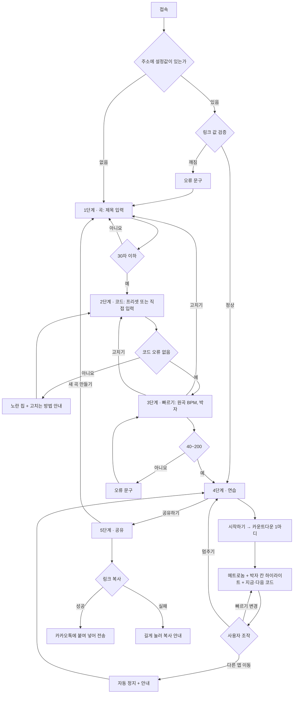

# PRD_SlowStrum

> 교회 찬양팀 기타 레슨을 위한 **코드 운지 + 느린 메트로놈 + 박자 그리드** 연습 웹페이지
> 작성자: 박지훈 (명지대 컴퓨터공학과 60232013) · 버전: v2.0 (MVP 구현 완료)
> 사이트: https://slowstrum.vercel.app · 코드: https://github.com/toothlessispeter/slowstrum · 디자인: [DESIGN.md](../DESIGN.md)

---

## 1. 프로젝트 개요

### 해결하려는 문제
나는 대학생이고, 일요일마다 교회에서 찬양팀 기타를 치는 고등학교 1학년 학생 두 명(김유호, 김예찬)에게 기타를 가르친다. 레슨을 하면서 아래 두 가지 문제가 반복된다.

1. **운지법 전달에 드는 작업**: 레슨에서 가르친 코드의 운지법을 매번 인터넷에서 찾아 캡처한 뒤 카카오톡으로 보낸다. 곡이 바뀔 때마다 검색 → 캡처 → 전송을 다시 해야 한다. 사이트마다 다이어그램 표기 방식이 달라서, 학생이 받는 자료의 형식도 매번 다르다.
2. **집 연습 기준 부재**: 캡처 이미지는 코드 모양만 보여주고, 어떤 순서·빠르기·박자로 코드를 바꿔야 하는지는 담지 못한다. 학생은 평일에 집에서 코드 전환을 어떻게 연습할지 모른다. 그 결과 일요일 레슨 한 번에 20분 넘게 지난주 코드를 복습하는 데 쓴다.

### 왜 중요한가
- 찬양팀 연주는 매주 일요일 예배에서 팀과 함께 진행된다. 예배 중에는 혼자 멈추거나 빠르기를 늦출 수 없다. 그래서 학생은 다음 일요일 전까지 원곡 빠르기에서 코드 전환을 박자에 맞출 수 있어야 한다.
- 레슨도 일요일에만 있다. 복습에 20분 이상 쓰면 그만큼 다음 주 곡을 배우는 시간이 줄고, 준비가 덜 된 상태로 다음 예배에 서게 된다.
- 복습이 길어지는 원인 중 하나는 학생이 받은 자료에 연습 기준(빠르기, 박자, 전환 시점)이 없다는 점이다. 자료에 이 기준이 들어가면 학생은 평일에도 레슨과 같은 방식으로 연습할 수 있다.
- 운지법 검색·캡처는 매주 곡 수만큼 반복된다. 코드 진행을 한 번 입력해서 같은 형식의 자료가 나오면 이 반복 작업이 없어진다.

### 목적
- 코드 진행만 입력하면 운지 다이어그램이 같은 형식으로 자동 표시되게 해서, 검색·캡처 작업을 없앤다.
- 같은 화면에서 느린 메트로놈과 박자 그리드로 코드 전환 시점을 보여줘서, 학생이 평일에 무엇을 어떤 빠르기로 연습할지 알 수 있게 한다.
- 입력한 진행을 링크 하나로 만들어 카카오톡으로 보내게 한다. 학생은 로그인 없이 링크를 열면 바로 연습 화면을 본다.
- 이를 통해 일요일 레슨의 복습 시간을 줄이고, 줄어든 시간을 다음 주 곡 준비에 쓴다.

### 성공 기준
| 지표 | 지금 | 목표 | 확인 방법 |
|---|---|---|---|
| 레슨 1회 복습 시간 | 20분 이상 | 10분 이하 | 레슨 4주 동안 직접 기록 |
| 곡 1개 자료 준비 시간 (검색·캡처·전송) | 곡마다 반복 | 링크 1개 생성으로 1분 이내 | 레슨 준비 때 직접 측정 |
| 학생의 평일 연습 | 연습 기준 없음 | 링크로 받은 빠르기에서 연습 후, 다음 레슨에서 빠르기를 5% 이상 올려 연주 | 레슨 시작 시 연습 화면으로 확인 |

### 범위 조건
- 로그인·회원가입 없음, 서버·데이터베이스 없음.
- 웹페이지 하나 안에서 곡 입력 → 코드 입력 → 빠르기 입력 → 연습 → 링크 공유가 모두 끝난다.
- 링크 공유는 제목·코드 진행·원곡 빠르기·박자·연습 빠르기를 URL 안에 담는 방식으로 한다. 그래서 서버에 저장하지 않아도 같은 화면이 열린다.

### 한 줄 정의
**코드 진행을 입력하면 운지 다이어그램과 느린 메트로놈 연습 화면을 링크 하나로 만들어 주는, 로그인 없는 찬양팀 기타 레슨용 웹페이지.**

---

## 2. 주요 타겟

### 대표 사용자 (학생)
| 항목 | 내용 |
|---|---|
| 인물 | 김유호, 김예찬 (고등학교 1학년), 교회 찬양팀 기타 담당 |
| 기타 실력 | 기본 오픈 코드 모양은 알지만, 원곡 빠르기에서 코드를 바꾸는 데 한 박자 이상 걸린다 |
| 사용 상황 | 일요일: 예배 연주 + 레슨. 평일: 학교·학원이 끝난 저녁에 집에서 짧게 연습 |
| 사용 기기 | 스마트폰. 카카오톡으로 받은 링크를 눌러 바로 연다. 기타를 든 채로 보면대나 책상 위 화면을 본다 |
| 현재 해결 방식 | 카카오톡으로 받은 운지법 캡처 사진을 넘겨 보며, 박자 기준 없이 코드 모양만 반복해서 잡아 본다 |
| 불편한 점 | 캡처 사진이 대화방에 흩어져 있어 이번 주 곡 코드를 다시 찾기 어렵다. 어떤 빠르기로 연습해야 할지 기준이 없다 |
| 회원가입 | 원하지 않는다. 평일 연습 시간이 짧아서, 가입 단계가 있으면 연습 시작이 그만큼 늦어진다 |

### 보조 사용자 (가르치는 사람)
작성자 본인. 대학생이며 일요일마다 교회에서 찬양팀 학생 두 명에게 기타를 가르친다. 레슨에서 다음 주 곡의 코드 진행을 입력해 화면으로 함께 연습하고, 레슨이 끝나면 그 진행을 링크로 만들어 카카오톡으로 보낸다. 노트북과 스마트폰을 모두 쓴다.

---

## 3. 핵심 기능 (MVP)

| 우선순위 | 기능 | 설명 | 완료 기준 | 상태 |
|---|---|---|---|---|
| P1 | **코드 다이어그램 자동 표시** | 코드 진행을 입력하면 쓰인 코드의 운지 다이어그램이 같은 형식으로 표시된다. 연습 중에는 **지금 칠 코드(크게)** 와 **다음 코드(작게)** 를 나란히 보여주고, 바뀌기 1박자 전에 다음 코드 테두리가 깜빡인다 | `G:4 D/F#:4 Em:4 C:4`를 입력하면 4개 코드의 다이어그램이 모두 표시되고, 재생 중 4박자마다 지금·다음 코드가 바뀐다 | 완료 |
| P1 | **느린 메트로놈 + 박자 그리드** | 원곡 빠르기(BPM)를 입력하고 연습 빠르기를 원곡의 25~100%로 낮춘다(5%씩). 마디×박자 칸 그리드에서 지금 박자가 메트로놈 소리와 함께 베이지로 채워지고, 코드가 바뀌는 칸 위에 코드 이름이 붙는다 | 원곡 120 BPM에서 50%를 고르면 60 BPM으로 소리가 나고 "60 BPM · 원곡의 50% 빠르기"가 표시된다. 10분 재생해도 소리와 하이라이트가 어긋나지 않는다 | 완료 |
| P1 | **연습 링크 공유** | 제목·진행·원곡 빠르기·박자·연습 빠르기를 URL에 담은 링크를 만든다. [링크 복사하기] 후 카카오톡에 붙여 넣어 보낸다 | 복사한 링크를 카카오톡에서 열면 로그인 없이 같은 설정의 연습 화면이 바로 열린다 | 완료 |

### MVP에서 뺀 기능
여러 곡 묶음 링크, 곡 저장, 가사 표시, 카포 계산, TAB 악보, 스트로크 패턴 → 6장 제외 범위 참고

---

## 4. 사용자 흐름

화면은 5단계로 나뉘고, 하단 [이전] / [다음] 버튼이나 상단 단계 표시(① 곡 ② 코드 ③ 빠르기 ④ 연습 ⑤ 공유)로 넘어간다. 앞 단계 입력에 오류가 있으면 뒤 단계로 갈 수 없다.

### 가르치는 사람 (일요일 레슨)
1. https://slowstrum.vercel.app 에 접속한다. 1단계가 열린다.
2. **1단계 · 곡**: 곡 제목을 입력한다 (예: `11/9 예배 2번 곡, 카포 2`). [다음]을 누른다.
3. **2단계 · 코드**: 자주 쓰는 진행을 고르거나 코드 진행을 직접 입력한다. 아래에 운지 미리보기가 나온다. [다음]을 누른다.
4. **3단계 · 빠르기**: 원곡 빠르기와 박자를 입력한다. 입력한 내용을 확인하고, 틀린 곳은 [고치기]로 돌아가 고친다. [연습 시작하기]를 누른다.
5. **4단계 · 연습**: 빠르기 슬라이더를 학생 수준에 맞게 낮춘다. [시작하기]를 누르고 학생과 함께 그리드를 보며 연습한다.
6. 학생이 막히는 마디에서 [멈추기]를 누르고, 빠르기를 더 낮춰 다시 시작한다.
7. 레슨이 끝나면 [공유하기]를 누른다.
8. **5단계 · 공유**: 링크에 담기는 내용을 확인하고 [링크 복사하기]를 누른다.
9. 카카오톡 대화방에 링크를 붙여 넣어 보낸다.

### 학생 (평일 집 연습)
1. 카카오톡에서 받은 링크를 누른다 (가입 없음).
2. 선생님이 정한 제목·진행·빠르기로 **4단계 연습 화면**이 바로 열린다.
3. [시작하기]를 누르고 1마디 카운트다운(4 · 3 · 2 · 1)을 듣는다.
4. 베이지로 채워지는 박자 칸과 지금·다음 코드를 보며 따라 친다.
5. 익숙해지면 [+5%]로 빠르기를 올린다.
6. 원곡의 100% 빠르기에서 끝까지 이어서 치는 것을 목표로 반복한다.

### 예외 상황
| 상황 | 처리 | 화면 문구 |
|---|---|---|
| 콜론 없이 입력 (`D4`) | 해당 칩을 노란색으로 표시, [다음] 비활성 | "D4"는 "D:4"처럼 코드와 박자 수 사이에 :를 넣어서 써 주세요. |
| 지원하지 않는 코드 (`Cadd9#11`) | 해당 칩을 노란색으로 표시, [다음] 비활성 | "Cadd9#11" 코드는 아직 쓸 수 없어요. 아래 목록에서 비슷한 코드를 골라 주세요. |
| 박자 수가 1~8 밖 (`G:12`) | [다음] 비활성 | "G:12"의 박자 수를 1에서 8 사이로 바꿔 주세요. |
| 코드 진행이 비어 있음 | [다음] 비활성 | 연습할 코드를 하나 이상 입력해 주세요. |
| 코드가 64개 초과 | [다음] 비활성 | 코드는 64개까지 넣을 수 있어요. |
| 원곡 빠르기가 40~200 밖 | [연습 시작하기] 비활성 | 빠르기는 40에서 200 사이 숫자로 입력해 주세요. |
| 입력 오류가 있는 상태 | 하단 바 가운데 안내가 노란색으로 바뀜 | 빨간 글씨로 표시된 부분을 고쳐 주세요 |
| 계산된 연습 빠르기가 20 BPM 미만 | 20 BPM으로 고정 | 가장 느린 빠르기(20 BPM)예요. |
| 링크 값이 깨짐 (잘린 링크, 잘못된 값) | 1단계로 이동 | 링크를 열 수 없어요. 선생님께 링크를 다시 보내 달라고 해 주세요. |
| 클립보드 복사 실패 | 링크 입력칸은 그대로 두고 안내 | 자동 복사가 안 됐어요. 위 링크를 길게 눌러서 복사해 주세요. |
| 브라우저가 소리를 막음 (자동재생 차단) | [시작하기]를 누른 순간에 오디오를 켬 | — |
| 재생 중 다른 앱·탭으로 이동 | 재생을 멈추고 첫 마디로 돌아감 | 다른 화면으로 나가서 멈췄어요. 시작하기를 누르면 처음부터 다시 시작해요. |
| 소리가 안 들릴 수 있음 (아이폰 무음 스위치) | 재생 중 하단에 안내 | 소리가 안 들리면 무음 모드를 끄고 볼륨을 올려 주세요. |

### 순서도

---

## 5. 입력과 출력

모든 화면 문구는 해요체로, 한 문장에 한 가지 내용만 담는다. 버튼은 누르면 일어날 일을 말한다. (자세한 규칙은 DESIGN.md 2장)

### 공통: 상단 바 · 하단 바
| 항목 | 입력 | 처리 | 출력 |
|---|---|---|---|
| 단계 표시 | 단계 번호 클릭 | 앞 단계가 모두 통과했으면 해당 단계로 이동 | 지금 단계는 베이지 원 + 베이지 글자, 갈 수 없는 단계는 흐린 회색. 상단 2px 진행 바가 (현재 단계 ÷ 5)만큼 베이지로 채워짐. 960px보다 좁으면 "2/5단계 · 코드" 한 줄 |
| [이전] | 클릭 | 한 단계 앞으로 이동 | 1단계에서는 비활성 |
| [다음] / [연습 시작하기] | 클릭 | 현재 단계 검증 통과 시 다음 단계로 이동, 주소에 설정값 반영 | 오류가 있으면 회색 비활성 + 가운데 안내 "빨간 글씨로 표시된 부분을 고쳐 주세요" |
| 브라우저 뒤로가기 | — | 주소의 `#단계`를 읽어 이전 화면으로 이동 | — |

### 1단계 · 곡 — "어떤 곡을 연습할까요?"
| 항목 | 입력 (형식 / 제한) | 처리 | 출력 |
|---|---|---|---|
| 곡 제목 | 텍스트, 선택 입력, 최대 30자 | 앞뒤 공백 제거 | 입력칸 아래 "안 적어도 괜찮아요 · 19/30자" |
| 학생 화면 미리보기 | 없음 (자동) | 입력한 제목을 그대로 표시 | "학생 화면에는 이렇게 보여요" 카드에 제목을 실제 크기로. 비어 있으면 "제목 없음" |

### 2단계 · 코드 — "어떤 코드로 연습할까요?"
| 항목 | 입력 (형식 / 제한) | 처리 | 출력 |
|---|---|---|---|
| 자주 쓰는 진행 | 카드 4개 중 1개 클릭 | 선택한 진행을 입력칸에 채움 | 선택한 카드에 베이지 테두리 + 이름 베이지 |
| 직접 입력하기 | 텍스트. `코드:박자 수`를 띄어쓰기로 구분 (예: `G:4 D/F#:4 Em:4 C:4`). 최대 64개, 박자 수 1~8 | 띄어쓰기로 나눠 코드 이름·박자 수 추출 → 지원 코드 목록과 대조 | 입력칸 위 설명 "G:4는 G 코드를 4박자 동안 친다는 뜻이에요." 입력칸 아래 칩 "G 4박자" "D/F# 4박자"… 오류 칩은 노란색 |
| 운지 미리보기 | 없음 (자동) | 진행에 쓰인 코드를 중복 없이 추출 | "코드 4개, 모두 16박자예요." + 코드별 운지 다이어그램 카드 |
| 쓸 수 있는 코드 보기 | 클릭 (열기/닫기) | — | 종류별 지원 코드 26개 목록 |

**자주 쓰는 진행 (찬양에 자주 쓰는 키)**
| 이름 | 진행 |
|---|---|
| G키 기본 진행 | `G:4 D:4 Em:4 C:4` |
| D키 기본 진행 | `D:4 A:4 Bm:4 G:4` |
| A키 기본 진행 | `A:4 E:4 F#m:4 D:4` |
| G키 베이스가 내려가는 진행 | `G:4 D/F#:4 Em:4 C:4` |

**지원 코드 26개**
| 종류 | 코드 |
|---|---|
| 메이저 | C, D, E, F, G, A |
| 마이너 | Am, Bm, Dm, Em, F#m, C#m |
| 7th | A7, B7, D7, E7, G7 |
| sus4 | Asus4, Dsus4, Esus4 |
| 분수 코드 | G/B, D/F#, C/E, A/C# |
| maj7 | Cmaj7, Fmaj7 |

### 3단계 · 빠르기 — "원곡은 얼마나 빠른가요?"
| 항목 | 입력 (형식 / 제한) | 처리 | 출력 |
|---|---|---|---|
| 원곡 빠르기 | 숫자 40~200 (기본 72) | 정수 변환 | 큰 숫자 + "BPM". 아래 "잘 모르면 72로 두고 연습하면서 맞춰도 괜찮아요" |
| 박자 | 토글 `4/4` / `3/4` / `6/8` (기본 4/4) | 마디당 박자 수 결정 (4 / 3 / 6) | 선택한 토글에 베이지 테두리·글자. 아래 "찬양곡은 대부분 4/4예요" |
| 입력한 내용 확인 | [고치기] 클릭 | 해당 단계(1단계 또는 2단계)로 이동 | 표: 제목 / 코드 / 길이("4마디, 16박자") |

### 4단계 · 연습 — (곡 제목)
| 항목 | 입력 | 처리 | 출력 |
|---|---|---|---|
| 곡 정보 | 없음 | — | 곡 제목 + "원곡 120 BPM · 4/4박자 · 코드 4개 · 4마디" |
| 빠르기 슬라이더 | 25%~100%, 5%씩 (기본 50%, 링크로 열면 링크의 값) | 연습 빠르기 = 원곡 빠르기 × % (반올림, 최소 20) | 하단 바 큰 숫자 "60 BPM" + "원곡의 50% 빠르기". 재생 중 바꾸면 다음 박자부터 적용 |
| [−5%] / [+5%] | 클릭 | 슬라이더 값 ±5% | 25%·100%에서 각각 비활성 |
| [시작하기] | 클릭 (노트북은 스페이스바도 가능) | 오디오 켜기 → 1마디 카운트다운 → 재생. Web Audio API로 소리를 0.1초 앞서 미리 예약하는 방식(lookahead 스케줄링)으로 박자를 만들어 화면과 소리가 어긋나지 않게 함 | 카운트다운 동안 화면 가운데 큰 베이지 숫자 4 · 3 · 2 · 1. 버튼이 [멈추기]로 바뀜 |
| [멈추기] | 클릭 | 재생 중단, 첫 마디로 돌아감 | 하이라이트 해제, 버튼이 [시작하기]로 돌아감 |
| 박자 그리드 | 없음 (자동) | 지금 박자 번호 계산 → 해당 칸 하이라이트. 진행 끝에서 처음으로 반복 | 한 줄에 2마디, 마디는 굵은 세로선. 지금 박자 칸은 베이지로 채움, 1박자 칸 위에 점, 코드가 바뀌는 칸 위에 코드 이름. 긴 진행은 지금 마디를 따라 자동 스크롤 |
| 지금 칠 코드 | 없음 (자동) | 지금 박자가 속한 코드 조회 | 큰 다이어그램(6줄 × 4프렛, 누르는 자리 점, 개방현 ○, 안 치는 줄 ×, 바레는 가로 막대) + 코드 이름 |
| 다음 코드 | 없음 (자동) | 다음 코드 조회 | 작은 다이어그램 + 코드 이름. 바뀌기 1박자 전에 테두리가 베이지로 깜빡임 |
| 1박자 강세 | 없음 | 마디 첫 박자는 높은 음, 나머지는 낮은 음 | 소리로 구분 |
| [공유하기] | 클릭 | 5단계로 이동 | — |

### 5단계 · 공유 — "학생에게 링크를 보내 주세요"
| 항목 | 입력 | 처리 | 출력 |
|---|---|---|---|
| 링크에 담기는 내용 | 없음 | — | 표: 제목 / 코드 / 원곡 빠르기("120 BPM · 4/4박자") / 연습 빠르기("60 BPM (원곡의 50%)") |
| 공유 링크 | 읽기 전용 (눌러서 전체 선택) | 설정값을 URL로 변환 | `https://slowstrum.vercel.app/?t=제목&p=G:4+D/F%23:4+Em:4+C:4&b=120&ts=4-4&s=50` |
| [링크 복사하기] | 클릭 | 클립보드에 복사 | "링크를 복사했어요. 카카오톡 대화방에 붙여 넣어 주세요." (2.5초) |
| [새 곡 만들기] | 클릭 | 입력값 초기화 후 1단계로 이동 | — |

**링크 형식**
| 키 | 의미 | 범위 |
|---|---|---|
| `t` | 곡 제목 | 최대 30자, 생략 가능 |
| `p` | 코드 진행 | 코드 64개, 박자 수 1~8 |
| `b` | 원곡 빠르기 | 40~200 |
| `ts` | 박자 | `4-4` / `3-4` / `6-8` |
| `s` | 연습 빠르기 % | 25~100, 5 단위 |

`#` 없이 설정값이 있는 링크는 4단계로 열리고, 값이 하나라도 범위를 벗어나면 1단계로 열리며 오류 문구가 보인다.

---

## 6. 제외 범위

| 기능 | 제외 이유 | 2차 버전 |
|---|---|---|
| 로그인 / 회원가입 | MVP 기능 3개는 모두 개인 데이터 저장 없이 동작한다. 가입 단계는 연습 시작만 늦춘다 | — |
| 여러 곡 묶음 링크 (그 주 곡 전체를 링크 하나로) | MVP는 곡 하나당 링크 하나로 동작을 먼저 검증한다 | ✅ |
| 곡 저장 (내 곡 목록) | 저장소가 필요해 범위가 커진다. MVP에서는 카카오톡 대화방의 링크가 저장 역할을 한다 | ✅ (브라우저 저장으로 먼저) |
| 가사 표시 | 찬양 가사는 저작권이 있고, 연습 목적이 코드 전환이라 필요하지 않다 | — |
| 카포 / 이조 계산 | MVP는 표시된 코드 모양 그대로 연습한다. 카포 위치는 제목칸 메모로 전달한다 (예: `카포 2`) | ✅ |
| TAB 악보 표시 | 입력·렌더링 난이도가 높다. MVP는 코드 단위 연습에 집중한다 | ✅ |
| 스트로크 패턴 (↓↑ 화살표) | 박자 그리드가 안정된 뒤에 추가한다 | ✅ |
| 음원 / 유튜브 영상 동기화 | 외부 서비스 연동이 필요하고 저작권 문제가 있다 | — |
| 알림 / 연습 리마인더 | 알림 권한이 필요하고, 연습 화면 동작과 무관하다 | — |
| 자동 빠르기 올리기 (N마디마다 +5%) | 수동 조절로 사용성을 먼저 확인한다 | ✅ |

---

## 7. 기술 구성

| 항목 | 선택 | 이유 |
|---|---|---|
| 프레임워크 | React 18 + Vite | 화면 5개 전환과 실시간 하이라이트를 상태로 관리하기 쉽다 |
| 소리 | Web Audio API (lookahead 스케줄링, 25ms마다 0.1초 앞 예약) | `setInterval`만 쓰면 박자가 밀린다. 소리를 미리 예약하고 화면은 예약 시각에 맞춰 갱신한다 |
| 운지 다이어그램 | SVG 직접 그리기 | 26개 코드를 같은 형식으로, 어떤 크기에서도 선명하게 보여준다 |
| 상태 저장 | URL 쿼리 + 해시 | 서버 없이 공유·뒤로가기·새로고침이 모두 된다 |
| 글꼴 | Pretendard, 고운바탕, IBM Plex Mono (npm으로 사이트에 포함) | 외부 글꼴 서버가 막힌 환경에서도 똑같이 보인다 |
| 배포 | GitHub → Vercel 자동 배포 | `main`에 올리면 1~2분 안에 사이트에 반영된다 |

---

## 8. 디자인 요약

자세한 내용은 [DESIGN.md](../DESIGN.md)에 있다.
- **목표**: 기타를 든 거리에서도 "지금 칠 코드"와 "지금 박자"가 한눈에 보이게 한다.
- **색**: 검정 바탕 + 흰 글자 + 포인트 색 베이지(#d8c8a8) 하나. 베이지는 지금 박자, 선택된 항목, 다음에 누를 버튼에만 쓴다.
- **크기**: 본문 17px, 설명 19px, 버튼 높이 56px, 박자 칸 84px.
- **문장**: 해요체, 한 문장에 한 가지 내용, 버튼은 일어날 일을 말한다.
- **모바일 우선**: 학생은 스마트폰으로 링크를 열기 때문에, 연습 화면은 위에서부터 곡 제목 → 지금/다음 코드 → 박자 그리드 → 하단 조작 바 순서로 둔다.

화면 캡처: [docs/wireframe](wireframe) (5단계 × 데스크톱/모바일)

---

## PRD 점검표

- [x] 문제를 한 문장으로 말할 수 있는가? → 운지법 캡처 자료에는 연습 기준이 없어서, 찬양팀 학생이 평일에 코드 전환을 연습하지 못하고 일요일 레슨마다 20분 이상을 복습에 쓴다
- [x] 사용자를 특정 인물로 적었는가? → 교회 찬양팀 기타를 맡은 고등학교 1학년 김유호, 김예찬
- [x] MVP 기능이 3개 이하인가? → 3개 (코드 다이어그램 / 느린 메트로놈 + 박자 그리드 / 링크 공유)
- [x] 모든 화면에 입력과 출력이 있는가? → 1~5단계 모두
- [x] 제외 범위가 3개 이상인가? → 10개
- [x] 성공 기준을 숫자로 적었는가? → 복습 시간 20분 → 10분 이하 외 2개
